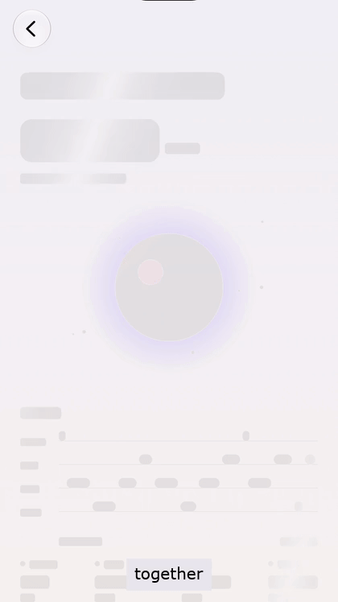
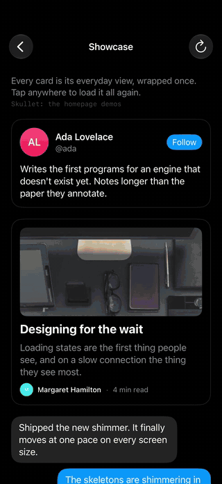
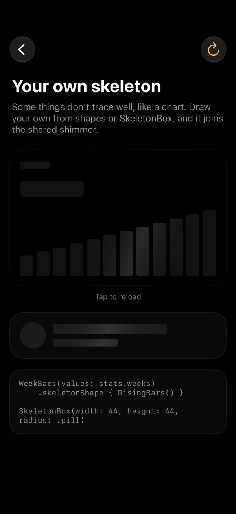
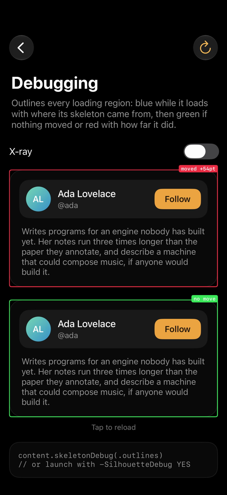

# Silhouette

Skeleton loading states for SwiftUI, traced from your real layout.

While your data loads, Silhouette lays out your own view with sample data, unseen, and draws a skeleton in exactly its shape: a bar for each line of text as it wraps, a block for each image, control and painted shape. Every skeleton on screen shimmers in step. When the data arrives, the content replaces its skeleton in place, so nothing on the page moves.

<p align="center"><sub>Screens styled after <a href="https://halo.terramind.io/?utm_source=github&utm_medium=readme&utm_campaign=silhouette">Halo</a>, built with Silhouette.</sub></p>

<p align="center">
  
  
</p>


- **No second skeleton to maintain.** The skeleton *is* your view. Change the view and the skeleton follows.
- **One shimmer.** Every skeleton keeps time by the same clock and its place on screen, however late it appeared.
- **No layout jump.** The content was laid out in the skeleton's place all along. New data of a different size eases to its height.
- **Native.** Dynamic Type, light and dark mode, Reduce Motion, VoiceOver and right-to-left layouts all work out of the box.

Requires iOS 17, macOS 14, tvOS 17, watchOS 10 or visionOS 1. Text is traced from the real glyph metrics on iOS 18, macOS 15, tvOS 18, watchOS 11 and visionOS 2 and later; earlier systems draw lines the way SwiftUI redacts text.

## Docs

The full documentation, with a recording for each feature, a theme playground and the API reference, is at **[silhouette.terramind.io](https://silhouette.terramind.io/docs/)**. Its source is [`docs/`](docs/), a static site with no build step: serve the folder (`python3 -m http.server -d docs`) to work on it.


## For coding agents

[`skills/silhouette/SKILL.md`](skills/silhouette/SKILL.md) teaches a coding agent to adopt Silhouette well: which API to pick, writing samples, hints, side effects, lists, accessibility, testing and a checklist to verify with the debug overlay. Copy the `skills/silhouette` folder into your agent's skills directory (for Claude Code, `.claude/skills/`), or fetch it from [silhouette.terramind.io/skill.md](https://silhouette.terramind.io/skill.md). [`llms.txt`](https://silhouette.terramind.io/llms.txt) indexes the docs for tools that read the web.

After changing the skill, run `scripts/sync-site.sh` so the site serves the same file; CI checks it.

## Install

Add the package in Xcode (**File → Add Package Dependencies…**) or in `Package.swift`:

```swift
.package(url: "https://github.com/terramind-org/silhouette.git", from: "0.1.0")
```

```swift
.target(name: "App", dependencies: [.product(name: "Silhouette", package: "silhouette")])
```

## Usage

### From your view and a sample

Pass the data, `nil` while it loads, and a sample of it. Your view is built from the sample, traced, and only ever receives real data on screen.

```swift
import Silhouette

Skeleton(user, sample: .sample) { user in
    ProfileCard(user: user)
}
```

Give the sample typical lengths: a name of a usual length, a bio that wraps like a real one. In debug builds, a `Skeleton` without a sample logs one to paste, with your data's shape and every value replaced.

### Any view, with a flag

Build the view however you like and say when it's loading:

```swift
ProfileCard(user: user ?? .sample)
    .skeleton(isLoading: user == nil)
```

Regions nest. Put the modifier on just the part that loads for partial loading; an inner region loads on its own once its outer one has revealed.

### Async work

`AsyncSkeleton` runs the work, shows the skeleton while it waits and reveals in place. Change `trigger` to load again; the old content stays on screen while it does.

```swift
AsyncSkeleton(sample: Quote.sample) {
    try await api.quoteOfTheDay()
} content: { quote in
    QuoteCard(quote: quote)
}
```

### Empty and error states

```swift
Skeleton(messages, sample: Message.samples) { Inbox(messages: $0) }
    .empty(messages?.isEmpty == true) { Text("No messages yet") }
    .failure(error) { error in ErrorView(error) }
```

### Remote images

Images never hold back a reveal. Each one keeps shimmering in its frame until it has loaded, then fades in.

```swift
SkeletonAsyncImage(url: photo.url) { $0.resizable().scaledToFill() }
    .frame(width: 120, height: 120)
    .clipShape(.rect(cornerRadius: 12))
```

### A single loading line

For work that's under way, such as an AI tool call, shimmer the line itself. It shares the skeletons' clock.

```swift
ShimmerText("Looking at your sleep")
Text(call.title).shimmer(call.isRunning)
```

<p align="center">
  
  
</p>

## Only what loads, loads

Bundled pictures, labels and other fixed values don't wait for data, so they don't wait for the skeleton either. `Skeleton` finds them on its own: it also lays your view out from a scrambled copy of the sample, and every piece that looks the same both ways shows as it is from the first frame. Only the parts that come from the data shimmer and animate in. For a view without sample data, mark what's fixed:

```swift
VStack {
    Text("Readiness").skeletonKeep()   // shows as it is; never a skeleton
    ReadinessRing(score: score)
}
.skeleton(isLoading: score == nil)
```

## Hints

Tracing gets most views right. Where it doesn't, mark the view:

```swift
Chart(points).skeletonBlock(cornerRadius: 8)   // one block, not traced
Text("New").skeletonIgnored()                 // left out of the skeleton
Avatar(user).skeletonShape { Circle() }       // your own skeleton shape
SkeletonBox(width: 40, height: 40, radius: .pill)  // a standalone placeholder
```

Surfaces in or near the page's own colour, such as a white card in light mode or a black one in dark, and dark mode's raised greys up to about 11 % white, are treated as containers: a card traces as its lines and pictures, not as one block. Containers stay on screen under the skeleton while it loads, so a card keeps its shape and only what's on it wipes in. For a container with any other background, mark the background with `skeletonIgnored()`:

```swift
content
    .background { RoundedRectangle(cornerRadius: 20).fill(.cardBackground).skeletonIgnored() }
```

A traced copy of your view is laid out to draw its skeleton. If a view starts work in `.task` or `.onAppear`, skip it in that copy:

```swift
@Environment(\.isDrawingSkeleton) private var isDrawingSkeleton
...
.task { if !isDrawingSkeleton { await model.load() } }
```

## Reveals

A reveal is the moment content replaces its skeleton. Set one for everything below a view:

```swift
ContentView().skeletonReveal(.smart)
```

| Reveal | What it does |
| --- | --- |
| `.smart` | The default. A skeleton waits 150 ms before it shows, so fast data never shows one, and content appears at once if someone is scrolling. Otherwise it comes in row by row down the screen, 40 ms apart (tighter on a long page, so the last row starts within 0.45 s), each line wiping in from its leading edge where its bar was, and the bar wiping out with it. Regions landing within 150 ms of each other wait for one another and share one cascade, and a region landing later waits for the lines above it, so the page always reads top to bottom. Rows off screen appear at once. The cascade keeps time by the frames it draws, so if the app stalls it waits rather than jumping ahead. |
| `.together` | Crossfades the whole skeleton into the content. |
| `.sequence` | The same wipe, row by row down its own region rather than the page. |
| `.sweep` | Uncovers the content behind one diagonal front at the shimmer's slant and pace. Content taller than one and a half screens crossfades instead. |
| `.instant` | Swaps at once. |

Every reveal is a `SkeletonReveal`. Start from one and change what you need:

```swift
var blurIn = SkeletonReveal.sequence
blurIn.enter = .blur

let bottomUp = SkeletonReveal(order: .custom { piece in
    let up = (piece.reveal.maxY - piece.rect.maxY) / max(piece.reveal.height, 1)
    return min(max(up, 0), 1) * 0.6
})

let wipeDown = SkeletonReveal(wipe: .custom { progress in
    let at = progress * 1.2
    return .init(stops: [.init(color: .black, location: max(0, at - 0.2)),
                         .init(color: .clear, location: max(at, 0.001))])
}, duration: 0.4)
```

| Field | Meaning |
| --- | --- |
| `order` | When each piece (a bar, image, control or shape) arrives: `.together`, `.byPosition` (sequence's), `.byRow` (smart's), or `.custom` returning each `RevealPiece`'s delay in seconds, `nil` for at once. `RevealPiece.byPosition` and `RevealPiece.byRow` are public to build on. |
| `enter` | Where content starts as it fades in: `blur`, `offset`, `scale`, `rotation`. Presets `.none`, `.blur`, `.rise`, `.zoom`. |
| `wipe` | A mask across the content for each moment of the reveal, replacing `order`; the outgoing skeleton gets its inverse. `.sweep` follows the shimmer. |
| `delay` | Seconds before the reveal starts. |
| `duration` | Seconds each piece takes to fade in, or the whole content for a reveal that comes in together. 0.2 by default; `0` is instant. |
| `hold` | How long a skeleton waits before it shows, so fast data never shows one. |
| `choose` | Decides as the content lands, from a `RevealContext`: how long the skeleton was up, the content's size and piece count, whether it's a refetch or someone is scrolling. |

Delays and durations stop at one second. New data of a different height eases to it over 280 ms. A reveal can't move the page. Under Reduce Motion every reveal is instant.

For `.smart` to see scrolling, mark scroll views (iOS 18, macOS 15, tvOS 18, watchOS 11, visionOS 2; it does nothing earlier):

```swift
ScrollView { Feed() }
    .skeletonTracksScrolling()
```

## Theming

```swift
ContentView()
    .skeletonTheme(SkeletonTheme(
        light: .init(base: .black.opacity(0.08), highlight: .white.opacity(0.55)),
        dark: .init(base: .white.opacity(0.10), highlight: .white.opacity(0.10)),
        animation: .shimmer,
        speed: .slow,
        direction: .angle(.degrees(20)),
        radius: .pill,
        text: .init(top: .capHeight, bottom: .descender)
    ))

Sidebar().skeletonTheme { $0.speed = .fast }   // change one option for one part
CompactList().skeletonText(SkeletonTextMetrics(top: .xHeight, bottom: .baseline))   // only the text metrics
```

| Option | Values |
| --- | --- |
| `light`, `dark` | The base fill and the highlight, per colour scheme. `SkeletonColors.tinted(_:)` builds both from one colour. |
| `colorScheme` | Force light or dark skeletons; `nil` follows the system. |
| `reducedMotion` | What skeletons do under Reduce Motion: `.holdStill` (default) or a quiet `.pulse`. |
| `animation` | `.shimmer`, `.groupShimmer` (a band per region), `.pulse` or `.none`. |
| `speed` | `.slow`, `.normal`, `.fast` or `.seconds(_:)`. |
| `direction` | `.leadingToTrailing` (follows right-to-left languages), `.trailingToLeading`, `.topToBottom`, `.bottomToTop` or `.angle(_:)`. |
| `bandWidth` | The width of the shimmer's highlight. |
| `radius` | How round each line of text is: `.auto`, `.points(_:)` or `.pill`. |
| `text` | How much of each line is drawn: from `ascender`, `capHeight` or `xHeight` down to `descender` or `baseline`. Cap height to descender by default, since SwiftUI sets lines with no extra leading. |

## Accessibility

- While loading, a region is one VoiceOver element that reads its label ("Loading" by default) and never the sample. Pass `label:` to say what's loading.
- Skeletons are hidden from VoiceOver and from hit testing.
- `onReveal` runs once the content has come in, for example to move accessibility focus. Silhouette also posts a layout-changed notification.
- Under Reduce Motion skeletons hold still and every reveal is instant, as Skullet does. Set the theme's `reducedMotion` to `.pulse` for a quiet pulse in place instead.
- Skeletons follow Dynamic Type, because they are traced from the text as it's laid out.

## Debugging

```swift
content.skeletonDebug(.outlines)     // or .all to add x-ray
```

Or launch with `-SilhouetteDebug YES` (`xray` for x-ray too), or call `setSkeletonDebug(.outlines)`. Each loading region is outlined: blue while it loads, labelled with where its skeleton came from; then green if nothing moved when the content arrived, or red with how far it moved. X-ray shows the hidden content faintly through its skeleton.

## Memory

A `Skeleton` remembers what it showed, so the next skeleton is exact. It's keyed by where the `Skeleton` is in your code; pass an `id` to share a shape between places or to tell apart instances in a `ForEach`. Within a launch it keeps the real data. Across launches, for `Codable` data, it keeps only the layout: a copy with every letter, digit and number replaced by a placeholder of the same length, in `UserDefaults`.

```swift
Skeleton(messages, sample: Message.samples, id: "inbox") { Inbox(messages: $0) }

forgetSkeletonShapes()   // on sign-out
```

## Testing

Skeletons are hidden from accessibility, so UI tests that query by accessibility label or identifier skip them. While a region loads, its content is hidden from accessibility too; wait for the real content's label. To skip reveals in UI tests, set `.skeletonReveal(.instant)`.

## The demo app

`Demo/` has an app with a page for every feature. Its screens are styled after [Halo](https://halo.terramind.io/?utm_source=github&utm_medium=readme&utm_campaign=silhouette), Terramind's health app, which uses Silhouette for its loading states, and use Halo's photographs with permission. Open `Demo/SilhouetteDemo.xcodeproj` and run it on an iPhone simulator or a Mac. The project is generated from `Demo/project.yml` with [XcodeGen](https://github.com/yonaskolb/XcodeGen); CI checks it's up to date.

## How it works

1. **Layout by SwiftUI.** Your content renders in place from the closest data there is, at opacity 0, so every size and line break is SwiftUI's own.
2. **A traced copy.** A second copy is laid out in the same space and drawn into a canvas. Text is drawn by a `TextRenderer` as one bar per line, trimmed to the font's metrics; everything else draws as it is.
3. **Coverage.** The canvas measures how far each pixel is from the page's colour, so anything painted becomes solid and surfaces near the page's colour drop out. That shape masks the skeleton fill.
4. **One clock.** The fill's highlight is positioned by the wall clock and the skeleton's place on screen, so every skeleton shimmers as one.
5. **The reveal.** The content fades, wipes or rises in over the skeleton in the space it already held.

The closest data is the data on screen, the data last shown under the same `id` in this launch, your sample, then a shape remembered from an earlier launch.

## Acknowledgements

Silhouette is a native take on the ideas in [Skullet](https://skullet.lochie.me) by Lochie Axon, a skeleton library for the web. The Swift package shares no code with it.

The website uses Skullet itself to load its landing page (MIT, bundled in [`docs/assets/vendor/skullet`](docs/assets/vendor/skullet) with its licence) and is set in [Geist](https://github.com/vercel/geist-font) (SIL Open Font License, in [`docs/assets/fonts`](docs/assets/fonts)).

## Licence

MIT. See [LICENSE](LICENSE).

---

<p>
  
  Silhouette by <a href="https://terramind.com/?utm_source=github&utm_medium=readme&utm_campaign=silhouette">Terramind</a>. Designed and built in <a href="https://terramind.com/nucleus?utm_source=github&utm_medium=readme&utm_campaign=silhouette">Nucleus</a>, Terramind's agent workspace. Loading states in <a href="https://halo.terramind.io/?utm_source=github&utm_medium=readme&utm_campaign=silhouette">Halo</a> are built with it. Inspired by <a href="https://skullet.lochie.me">Skullet</a>.
</p>
